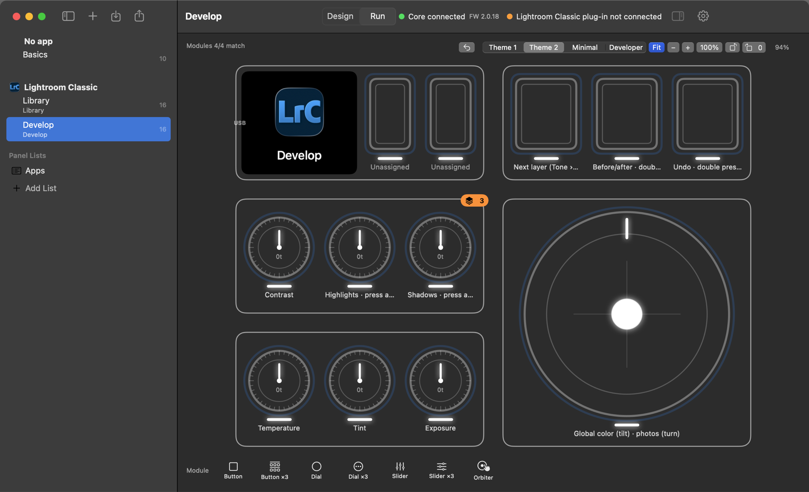
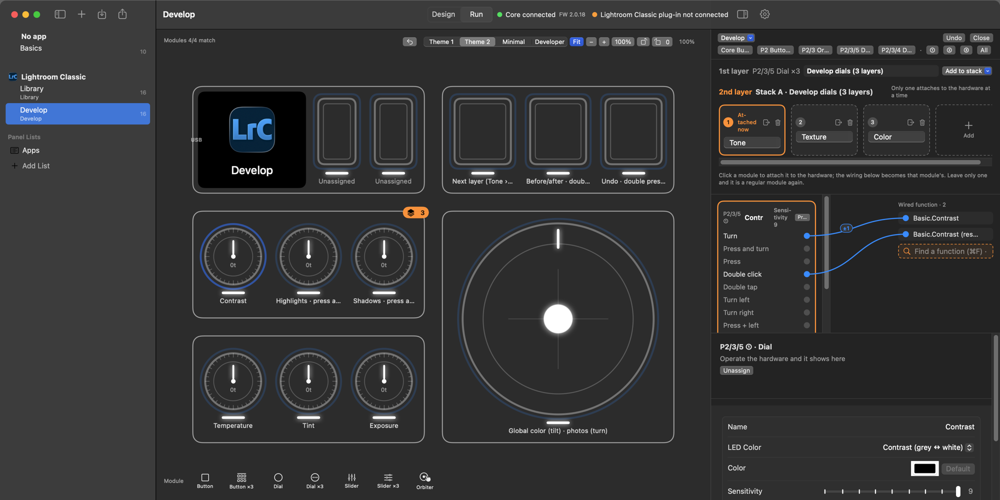

# Knobtile

An unofficial, native macOS app for the Monogram Creative Console (Core, buttons, dials, sliders, Orbiter).
It talks to the hardware directly, keeps your profiles, and lets **plugins** add functions for any app.



Knobtile is not made by, affiliated with, or supported by Monogram. It contains no Monogram code or files.

- macOS 14 or later, Apple silicon or Intel
- UI in English and Korean
- No analytics, no network access except the local connections to plugins

## What it does

- Profiles per app, switched automatically when the app comes to the front; profiles per screen inside an app (Lightroom's Library and Develop)
- Buttons, dials, sliders and the Orbiter run shortcuts, macros, scrolling, media keys, volume and brightness, or a plugin's functions
- An on-screen map of the current profile, and lists you can open from a button
- Plugins: a folder with a few JSON files, and optionally a small helper program in any language. See [Docs/plugin-spec-v1.md](Docs/plugin-spec-v1.md)



## Install

### Build it yourself (recommended)

You need the Xcode command line tools (`xcode-select --install`).

```sh
swift test        # optional
./make-app.sh     # writes build/Knobtile.app (universal)
./make-app.sh dist  # the same, signed ad hoc and packed as build/Knobtile-<version>.zip to hand out
cp -R build/Knobtile.app /Applications/
```

`make-app.sh` signs with your own Apple Development certificate when you have one (a free Apple ID in Xcode is enough), otherwise ad hoc.
With a certificate, macOS keeps the Accessibility permission across rebuilds; with an ad hoc signature you may have to grant it again after each build.

### A downloaded build

A release has two files: `Knobtile-<version>.zip` (the app) and `Knobtile-Lightroom-<version>.zip` (the `Plugins/lightroom` and `LightroomPlugin/Knobtile.lrplugin` folders, for those who do not download the source).

Downloaded builds are not notarized, so macOS refuses to open them the first time:

1. Unzip, move Knobtile to Applications, and open it. macOS says it was "Not Opened": click **Done** (not Move to Trash).
2. Open System Settings › Privacy & Security, scroll down, and click **Open Anyway**.

Or, in Terminal: `xattr -dr com.apple.quarantine /Applications/Knobtile.app`

### First run

1. Quit Monogram Creator if it is running: only one program can hold the Core's serial port.
2. Open Knobtile and grant **Accessibility** when asked (System Settings › Privacy & Security › Accessibility). Knobtile needs it to send shortcuts, clicks and scrolling to other apps.
3. Plug in the Core. Your modules appear on the board.
4. If Monogram Creator's profiles are on this Mac (`~/Library/Application Support/Monogram/Service/state.json`), Knobtile reads them on its first run. That file is never changed.

## Plugins

Only **System** (shortcuts, scrolling, media, volume) is inside the app. Everything else is a plugin folder. This repository has one, in [`Plugins/`](Plugins):

| Plugin | How it talks to the app | Needs |
|---|---|---|
| `lightroom` | TCP to a Lightroom Classic plug-in | `LightroomPlugin/Knobtile.lrplugin`, see below |

To install one: Knobtile › Settings (⌘,) › **Plugins** › **Add…**, pick the plugin's folder, then **Restart Knobtile**.
**Add Starter Profiles** on a plugin's row adds a ready-made profile for it. The starter profiles are laid out for a Core, a 3-button module, an Orbiter and two 3-dial modules; with other modules, use them as examples.

A profile whose plugin is not installed is marked **Plugin missing**; its shortcuts still work.

### Lightroom Classic

1. Install the `lightroom` plugin in Knobtile as above.
2. In Lightroom Classic: File › Plug-in Manager… › Add, and pick `LightroomPlugin/Knobtile.lrplugin`. Keep that folder where it is; Lightroom loads it from there.
3. Restart Lightroom. Knobtile connects a few seconds after Lightroom starts (ports 50120 and 50121 on 127.0.0.1).

If it does not connect: File › Plug-in Extras › Reconnect Knobtile. The plug-in's log is `~/Library/Logs/Adobe/Lightroom/LrClassicLogs/Knobtile.log`.
Tested with Lightroom Classic 16.0.1.

## Writing a plugin

[Docs/plugin-spec-v1.md](Docs/plugin-spec-v1.md) is meant to be all you need ([한국어](Docs/plugin-spec-v1.ko.md)). The smallest working example is [Docs/examples/counter](Docs/examples/counter): two JSON files and a 12-line Python helper.

## Your data

- Profiles and settings: `~/Library/Application Support/Knobtile/state.json` (a dated backup is written beside it at launch)
- Installed plugins: `~/Library/Application Support/Knobtile/Plugins/`
- To start over, quit Knobtile and delete `state.json`

## Source layout

| Target | What it is |
|---|---|
| `CoreV2` | serial driver for the Core |
| `Engine` | profiles, plugin loader, actions, module state machines, plugin connections |
| `Knobtile` | the SwiftUI app |
| `coremon`, `monoengine` | command line tools: raw device frames, a headless engine |

Hardware tested: Core with a 3-button module, an Orbiter and two 3-dial modules. Single buttons, dials and sliders, and the 3-slider module are implemented but less tested.

## How this was built

Knobtile was built by one person working with AI models (Claude Code) over 9 working days in November 2026.
The models wrote the code. The author decided what to build, tested every change on the real hardware, and sent it back when it was wrong.

| | The author | The models |
|---|---|---|
| Did | design, decisions, testing on the hardware | code, tests, documents |
| Volume | 531 messages, 30+ photos and screenshots | 3,909 responses, 3,836 commands and file operations |
| Time | about 32 hours | about 39 hours |

What the author's 531 messages were:

| Kind | Messages | Share |
|---|---|---|
| Test results and bug reports | 174 | 33% |
| Questions and requests for proposals | 130 | 24% |
| Requirements and design | 111 | 21% |
| Decisions | 78 | 15% |
| Housekeeping | 38 | 7% |

| Model | Working time | Responses |
|---|---|---|
| Claude Fable 5.1 | 18.7 h | 1,916 |
| Claude Fable 5.2 | 15.6 h | 1,460 |
| Claude Opus 5.5 | 4.5 h | 533 |

<sub>Counted from the session logs up to 22 Nov 2026. Times are estimates: for the models, gaps of up to 5 minutes between two events; for the author, the time from a model's answer to the next message, up to 30 minutes. The kinds were assigned by reading each message; some fit more than one.</sub>

## License

MIT, see [LICENSE](LICENSE). "Monogram" and "Creative Console" are names of their owner's products, used here only to say what hardware this works with.
